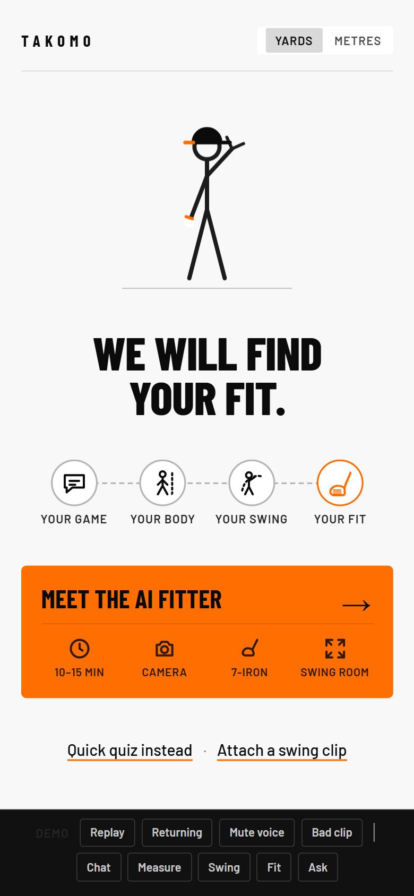
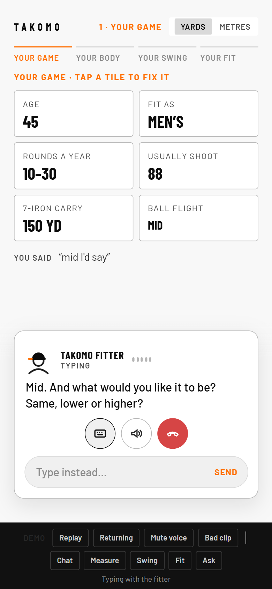
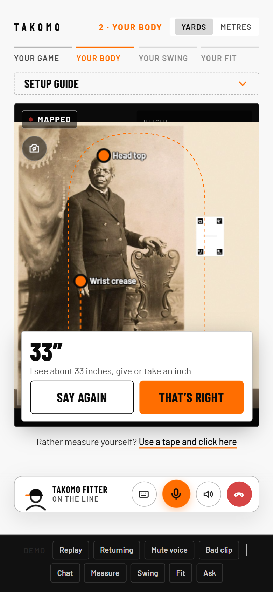
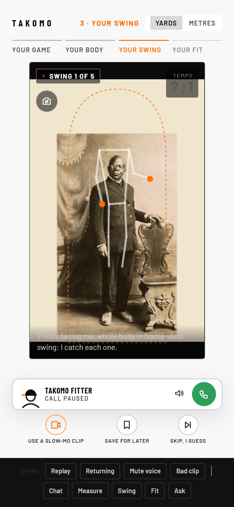
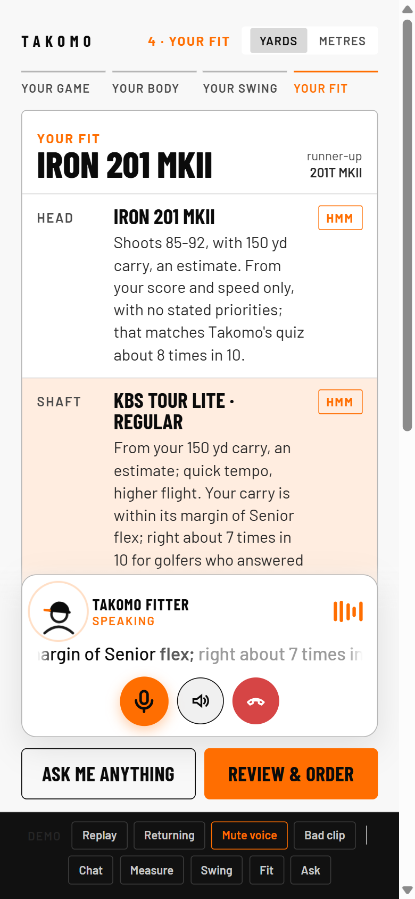

# The Fitter in Your Pocket

**An AI iron fitter for Takomo Golf, on your phone.** Talk to it like a fitter, stand in front of the camera, swing, and get
your iron spec with the reason and the confidence for every part.

**Team DynamicDuo · Takomo Golf challenge · Since AI Hackathon 2026 (Turku, 6–8 Nov 2026)**

### ▶ Live demo: **[takomo-fitter.vercel.app](https://takomo-fitter.vercel.app)**

Open it on a phone or a laptop with a camera. The microphone is optional: you can type to the fitter instead.

| 1 · Hello | 2 · Your game | 3 · Your body | 4 · Your swing | 5 · Your fit |
|:---:|:---:|:---:|:---:|:---:|
|  |  |  |  |  |
| Meet the AI fitter | A call, not a form | Measured, not guessed | Caught live, no tap | Every part explained |

## What it does

1. **Your game: a real conversation.** An ElevenLabs voice agent asks Takomo's fitting quiz as six natural questions
   (age and men's or women's, rounds, usual score, 7-iron speed or carry, ball flight now and wanted). Every answer
   fills a tile the moment it's understood. "I don't know" gets a plain explanation and easy choices. Say "bye" and
   it hangs up.
2. **Your body: the camera measures.** You say your height once; the live camera finds your head, wrist crease and
   the floor and measures your wrist-to-floor, the number people usually get about 3 cm wrong with a tape. Drag a dot
   if it's off and the number updates.
3. **Your swing: like a video call.** Just swing. Body tracking spots each swing on its own and reads its tempo
   (backswing and downswing time) from every camera frame. Five swings are combined. You can also upload as many of
   your own swing videos as you like. Video never leaves the phone; only the hand track is sent.
4. **Your fit: every part explained.** Head, shaft (model and flex), length, lie and grip from **Takomo's own fitting
   rules**, each with the reason and how sure it is (Sure, Hmm or Guess), plus the runner-up head and any close call.

## How it stays honest

- **The AI never picks a spec.** Takomo's rules engine decides; the AI only asks the questions and explains the result.
- **Measured and said are kept apart.** Every tile shows where its value came from (said, seen, estimated).
- **Confidence is calibrated.** Levels were learned on 20,000 and checked on 3,000 other golfers from the Takomo
  Fitting Lab data (simulated data: this is a prototype).
- **No swing tips.** Takomo's brand rule: clubs don't fix swings, and we don't say they do.

## How it works

| Part | What it is |
|---|---|
| Frontend | One mobile-first HTML page (`app/static/fitter/`), with the call dock, tiles and camera cards |
| AI fitter | ElevenLabs Conversational AI (voice and text), with client tools that save answers and read the fit |
| Camera | MediaPipe Pose in the browser: live tracking, wrist-to-floor, swing catching, video uploads |
| Backend | FastAPI (`app/`): answer parsing, sessions, the swing tempo analysis, the fit and its evidence |
| Engine | The Takomo Fitting Lab kit (`kit/takomo_fit`), Takomo's current fitting rules |
| Hosting | Vercel (Python), sessions in Upstash Redis |

## Run it locally

```bash
python -m venv .venv
.venv/Scripts/python -m pip install -r requirements-dev.txt     # macOS/Linux: .venv/bin/python
.venv/Scripts/python -m uvicorn app.server:app --port 8765       # then open http://localhost:8765
```

For the voice fitter, put `ELEVENLABS_API_KEY=...` in `.env` (git-ignored) and run
`.venv/Scripts/python tools/setup_elevenlabs_agent.py` once. Tests: `.venv/Scripts/python -m pytest`.

> **Takomo's files are not in this public copy.** Takomo Golf's product data and participant pack were shared for
> the Since AI Hackathon 2026 only and aren't covered by an open licence (see `kit/NOTICE`). To run the app, put
> `takomo_products.json` from the challenge ZIP in `kit/takomo_fit/data/`. The [live demo](https://takomo-fitter.vercel.app)
> runs with it.

More detail (calibration, validation, the earlier design): [`docs/TECHNICAL_NOTES.md`](docs/TECHNICAL_NOTES.md).

## Licence and attribution

- Our code: the team's work for the hackathon.
- `kit/takomo_fit`, `kit/camera`: MIT, © 2026 Since AI ry. Synthetic data: CC BY 4.0 (`kit/LICENSE`).
- Takomo product names and data belong to **Takomo Golf** (`kit/NOTICE`).
- MediaPipe Tasks Vision and the pose model: Apache 2.0, © Google (`app/static/vendor/mediapipe/`).
- Voice by ElevenLabs. Sample photo: Library of Congress, public domain.
- A hackathon prototype, not an official Takomo Golf product.
